# Preword: ASM Code Lens becomes NASM Code Lens – a major update

"ASM Code Lens" started as a tool for Z80, but over time it was increasingly used for x86 as well and gained x86 syntax highlighting to match.

However, it became more and more difficult for me to support both worlds — and the various x86 assemblers — with a single one-size-fits-all approach. Since there was no distinction between assemblers, NASM code would end up with Z80 syntax highlighting applied to it, and vice versa.

That was unsatisfying, and I'd wanted to change it for years. Now it's finally here: version 3 brings a major overhaul that does justice to the requirements of the different assemblers while keeping compromises to a minimum.

Since most users work with nasm, this is now reflected in the name too: "ASM Code Lens" becomes "NASM Code Lens" — nasm is now the default assembler.

Other assemblers such as MASM, gas, and sjasmplus are also supported and can be configured globally or per workspace.

Important: Since the extension now distinguishes between assemblers, please check your settings after updating to [make sure the correct assembler is selected for your project](#new-in-version-30-assembler-awareness).
If you use the NASM assembler it will work out of the box, you don't need to do anything.


# Description

NASM Code Lens is a Visual Studio Code extension that enhances working with assembly source code by providing language-server features such as navigation, symbol analysis, and syntax highlighting.

Version 3.0 introduces explicit assembler selection, which enables more accurate syntax highlighting and behavior tailored to the assembler you actually use, even on a per-workspace basis.

This was a very extensive change. Almost all of the code was rewritten. Despite extensive testing, **please bear with me if you encounter any bugs, and please take advantage of the option to report them**.

# Key Features
- [Syntax highlighting](#syntax-highlighting) for x86 and Z80 assembly
- [Code Lenses](#code-lenses)
- [Outline view](#outline-view)
- [Hover information](#hovering)
- [Open symbol by name](#open-symbol-by-name)
- [Go to Definition](#goto-definition)
- [Rename labels](#rename-label)
- [Code folding](#code-folding)
- [Dead code detection (unreferenced labels)](#find-dead-code)
- Completions
- [Markdown code block highlighting](#syntax-highlighting)
- Built-in [hexadecimal calculator](#hexadecimal-calculator)

# New in Version 3.0: Assembler Awareness
NASM Code Lens 3.0 lets you explicitly **select which assembler syntax is used**, enabling more precise syntax highlighting and parsing.

Supported Assemblers

x86
- NASM
- MASM
- GAS

Z80
- sjasmplus

**Global and Per-Workspace Configuration**

You can configure the assembler globally or per workspace/project, making it easy to work with multiple codebases that use different assemblers.

This avoids generic “one-size-fits-all” highlighting and significantly improves readability and correctness of assembler syntax.

You can change it globally or per workspace in the settings:
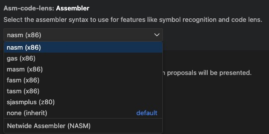

For each assembler you can choose which file extensions are used:
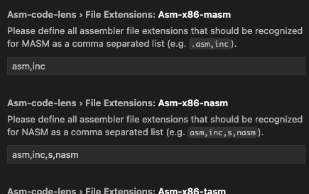


If "NASM Code Lens" version 3 is started for the first time the assembler id is set globally to x86/nasm (language id: asm-x86-nasm).
If you are using some other assembler change it via:


# Language Ids
Some background information:
"NASM Code Lens" now uses separate language IDs:
- asm-x86-nasm
- asm-x86-masm
- asm-x86-gas
- asm-z80-sjasmplus
- asm-z80-sjasmplus-list

This allows each assembler to have its own syntax highlighting rules.
Before that (v2.x), a shared language ID tried to include the keywords of all assemblers in a single grammar, which caused incorrect highlighting in some cases.

Note: The old language IDs (asm-collection and asm-list-file) have been removed and are no longer valid. "NASM Code Lens" will automatically migrate them when it starts. Do not use the old language IDs anymore.

# Syntax Highlighting
Syntax highlighting depends on the selected assembler (language ID).

ASM files are highlighted as soon as they are opened.

As a special feature, syntax highlighting also works for code blocks in Markdown files.

Just add ```asm-nasm```, ```asm-masm```, ```asm-gas```, or ```asm-sjasmplus``` to your code blocks. You can also use ```asm-z80``` as a synonym for ```asm-sjasmplus```.

Here is an example:

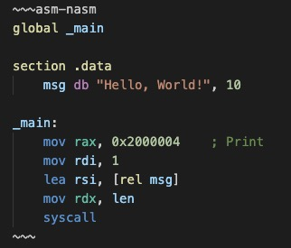


# Code Lenses
Code lenses are the core feature of this extension and the reason for its name.
A code lens displays the number of references above a label name:

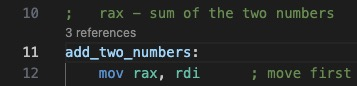

Code lenses are a powerful way to quickly see how labels are used and to navigate through the source code:

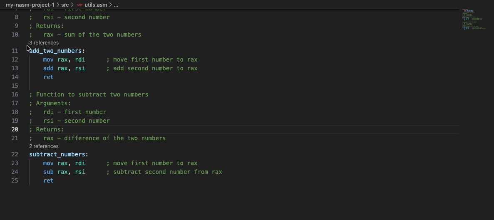

Note: If a label has a reference count of 0, it is not used anywhere else. That means it is either dead code or unused data.

Another way to use code lenses is to right-click a label and choose “Find All References.”
The references are then shown in the sidebar instead of inline.

# Outline View
An outline view of the assembly is shown and can be used for navigation:

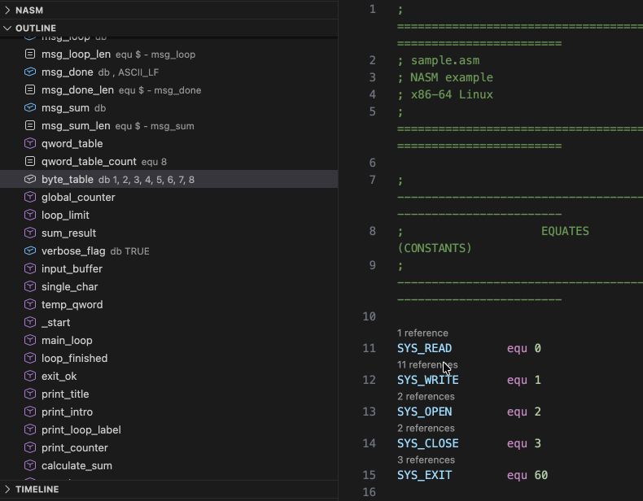

# Hovering
When you hover over labels, the subroutine description is shown if available:

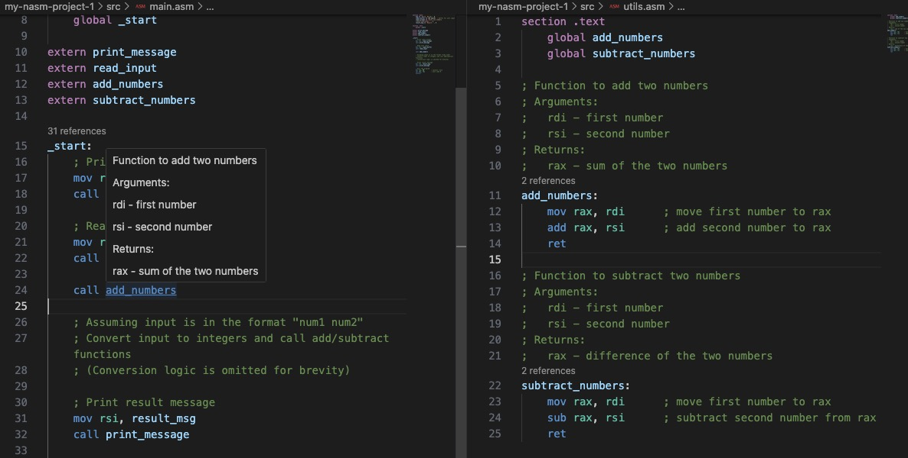

# Open Symbol by Name
Click in the title bar and enter a symbol prefixed with # to navigate quickly:

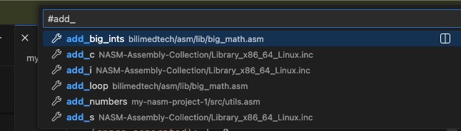

# Goto Definition
Right-click a label and select "Go to Definition" to navigate to it:

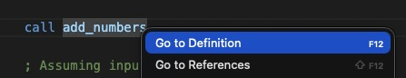

# Rename Label
Right-click a label, select "Rename Symbol", and choose a new name to rename it in all files:

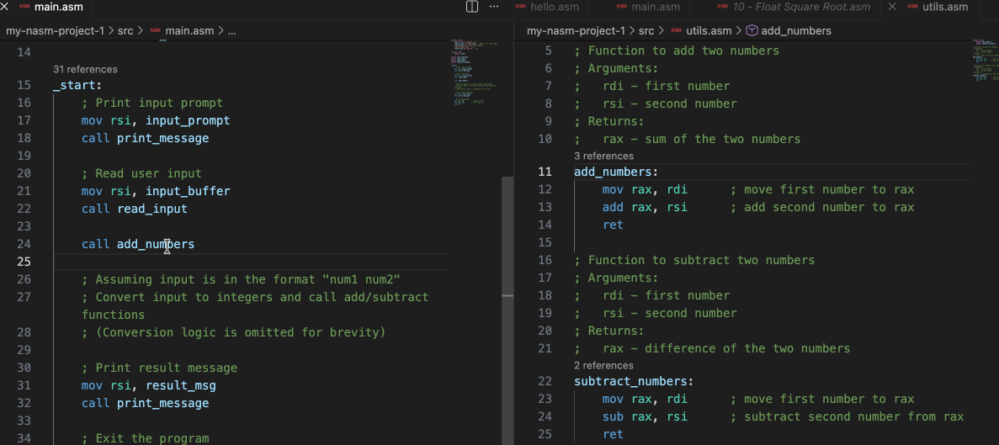

# Code Folding
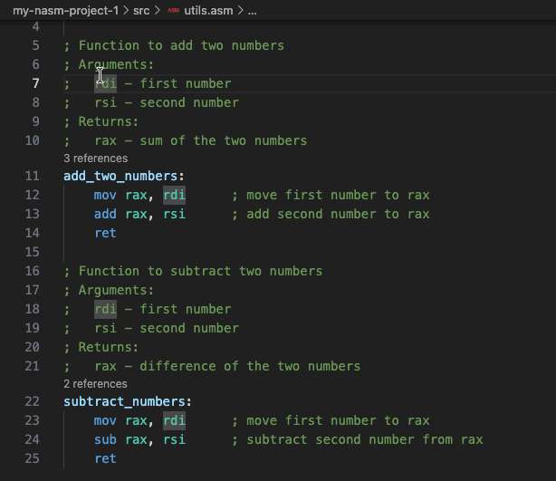

# Find Dead Code
Right-click an assembler file in the text editor and select 'Find Labels with no Reference'

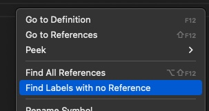

to get a list of labels (in the OUTPUT pane) that are not referenced anywhere in the workspace.

This can help you find dead code, because code or data that is not referenced is usually not used, or the label is unnecessary.

# Hexadecimal Calculator
As an extra, you will find a hexadecimal calculator/converter in the sidebar:

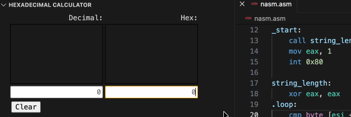
